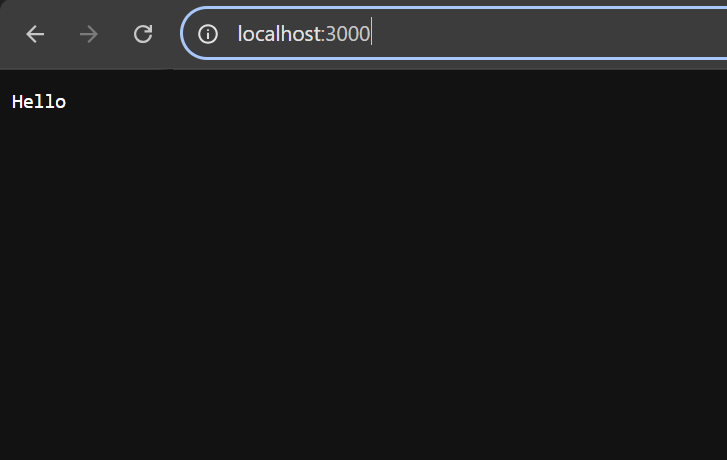
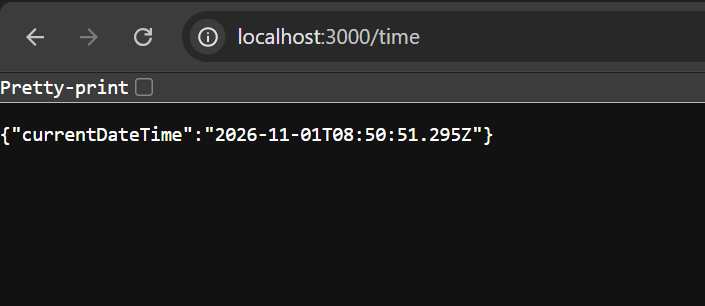
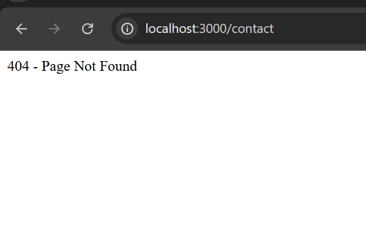

# Lab 1: Node.js and Express Server

## Student Details

* Name: Thrisha
* Registration Number: 252U1R9143
* Section: CSE GEN AI 112
* Course: Backend Development Fundamentals
* Institution: Aurora Deemed to be University

## Objective

To create a Node.js project and develop a web server using the built-in HTTP module and Express.js.

## Technologies Used

* Node.js
* Express.js
* JavaScript
* npm

## Installation and Execution

Install dependencies:

```bash
npm install
```

Run the basic HTTP server:

```bash
node basic-server.js
```

Run the Express server:

```bash
node server.js
```

Open in browser:

http://localhost:3000

## Endpoints

| Method | Path         | Description             | Status |
| ------ | ------------ | ----------------------- | ------ |
| GET    | /            | Welcome message         | 200    |
| GET    | /about       | Student details in JSON | 200    |
| GET    | /time        | Current date and time   | 200    |
| GET    | Unknown path | Page Not Found          | 404    |

## Screenshots

Add screenshots of the working routes in the screenshots folder.

## Notes

Successfully created a Node.js HTTP server and an Express server. Implemented GET routes and tested the server responses.

## Screenshots

### 1. Basic Server


### 2. About Page


### 3. Time Page


### 4. 404 Page

