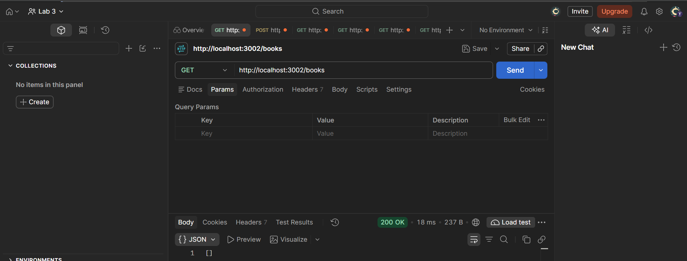
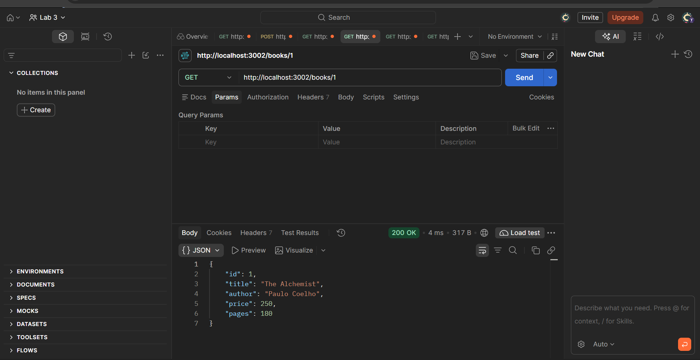
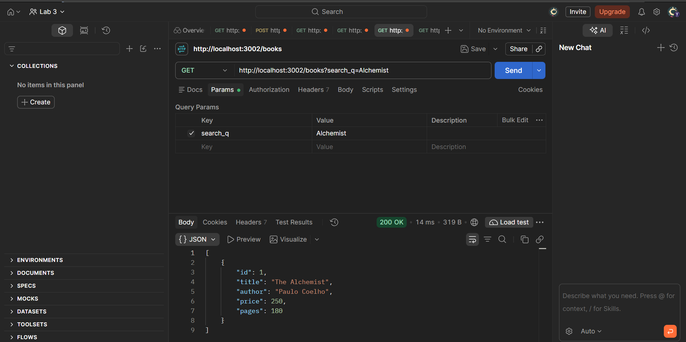
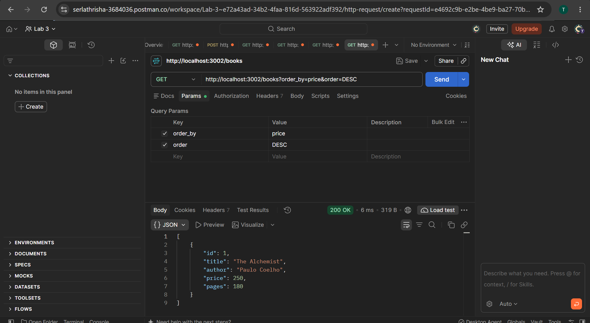
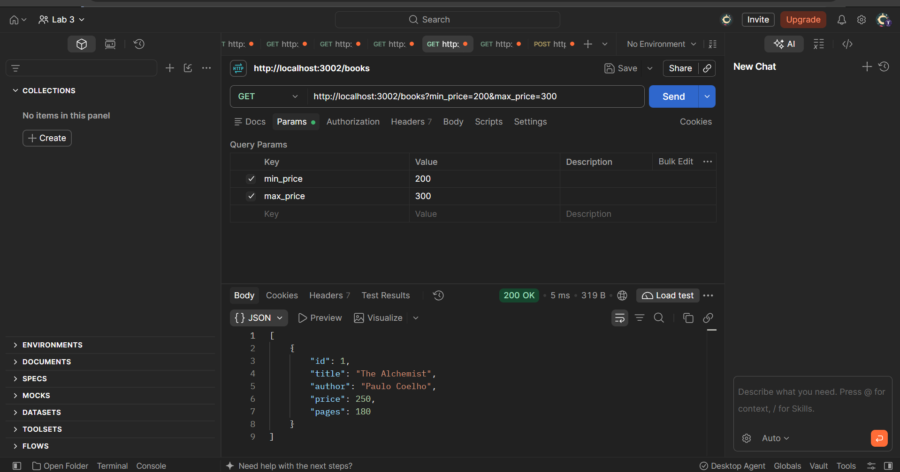
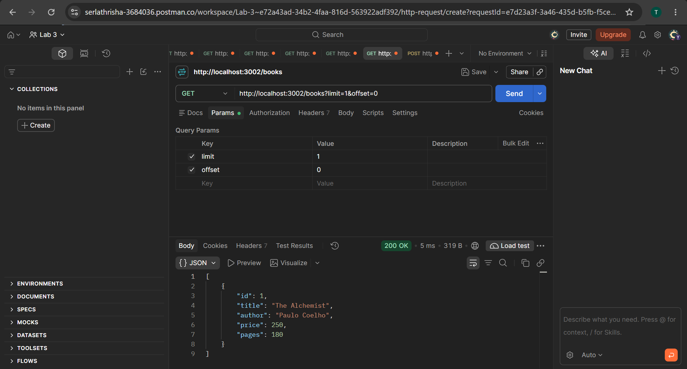
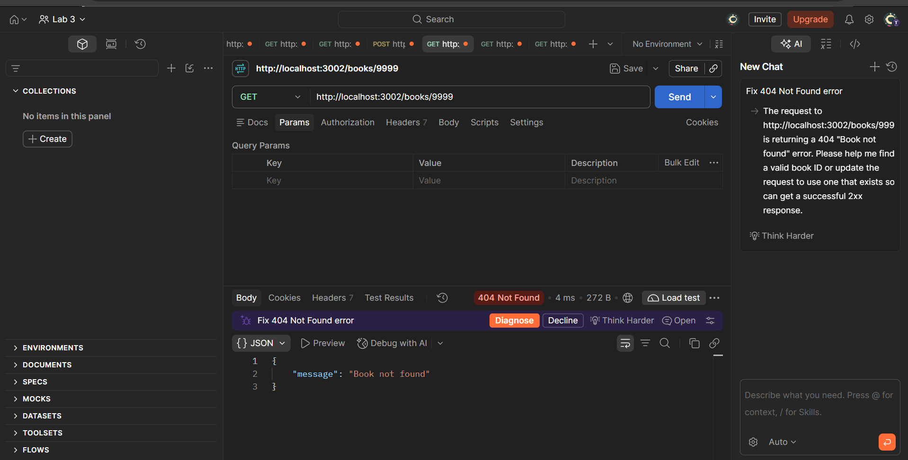
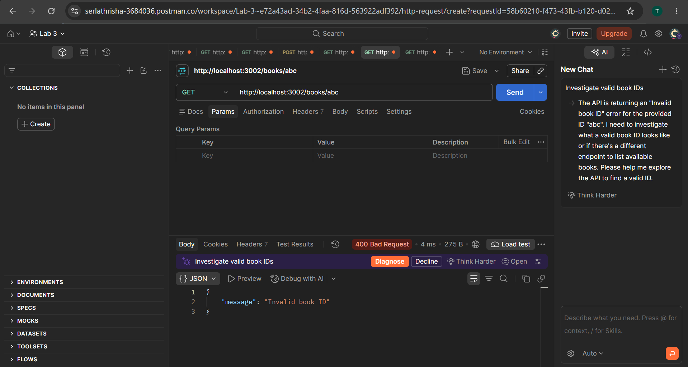
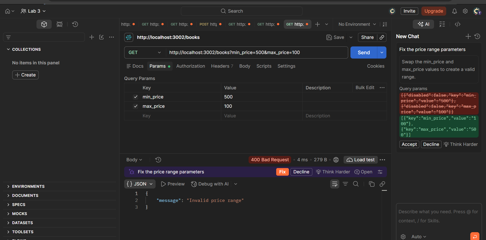
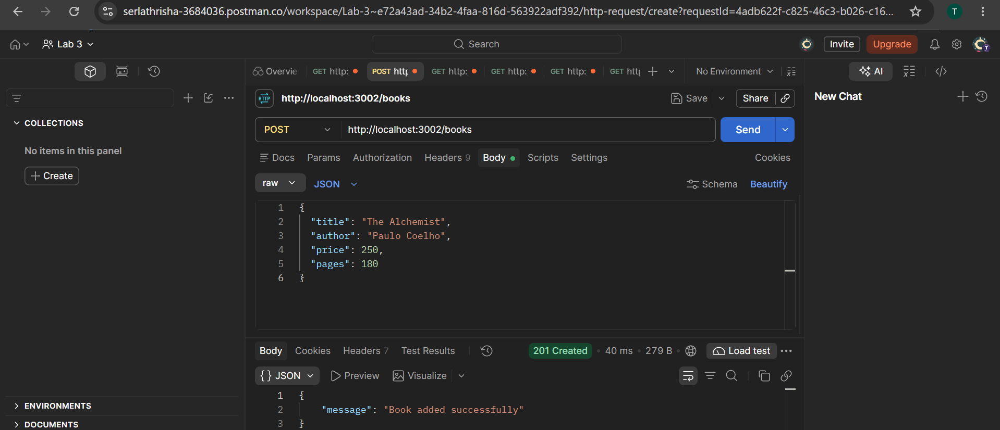

# Lab 3: REST API, Query Parameters, Validation and Debugging

## Student Details
- **Name:Serla Thrisha
- **Registration Number:**252U1R9143
- **Course:** Backend Development Fundamentals
- **Lab:** 3

## Objective
To develop RESTful APIs using Express.js and SQLite, including query parameters, input validation, and error handling.

## Technologies Used
- Node.js
- Express.js
- SQLite (`sql.js`)
- Postman
- Visual Studio Code

## Installation

Open a terminal inside the `lab-03` folder and run:

```bash
npm install
```

## Run the Server
Run:

```bash
npm start
```

The server runs at:

`http://localhost:3002`

## API Endpoints

| HTTP Method | Endpoint | Description |
|---|---|---|
| GET | `/books` | Get all books |
| GET | `/books/:id` | Get a book by ID |
| POST | `/books` | Add a new book |
| PUT | `/books/:id` | Update a book |
| DELETE | `/books/:id` | Delete a book |

## Query Parameters for GET `/books`

| Parameter | Description |
|---|---|
| `search_q` | Search books by title |
| `order_by` | Column used for sorting |
| `order` | Sort order: `ASC` or `DESC` |
| `min_price` | Minimum book price |
| `max_price` | Maximum book price |
| `limit` | Maximum number of records to return |
| `offset` | Number of records to skip |

Examples:

- `http://localhost:3002/books?search_q=Alchemist`
- `http://localhost:3002/books?order_by=price&order=DESC`
- `http://localhost:3002/books?min_price=200&max_price=300`
- `http://localhost:3002/books?limit=1&offset=0`

## Validation and Error Handling

- **200 OK** – Request completed successfully.
- **201 Created** – Book created successfully.
- **400 Bad Request** – Invalid input or request data.
- **404 Not Found** – Requested book does not exist.
- **500 Internal Server Error** – Unexpected server error.

The API validates required book details, numeric price values, book IDs, query parameters, and price ranges. Error responses use a JSON message.

## Postman Testing

The API endpoints and validation cases were tested using Postman. Screenshots of the requests and responses are stored in the `screenshots` folder.

## Conclusion

The Lab 3 REST API was implemented using Express.js and SQLite. CRUD operations, searching, sorting, price filtering, pagination, input validation, and error handling were tested using Postman.
## Postman Screenshots

### GET Requests











### POST Requests

